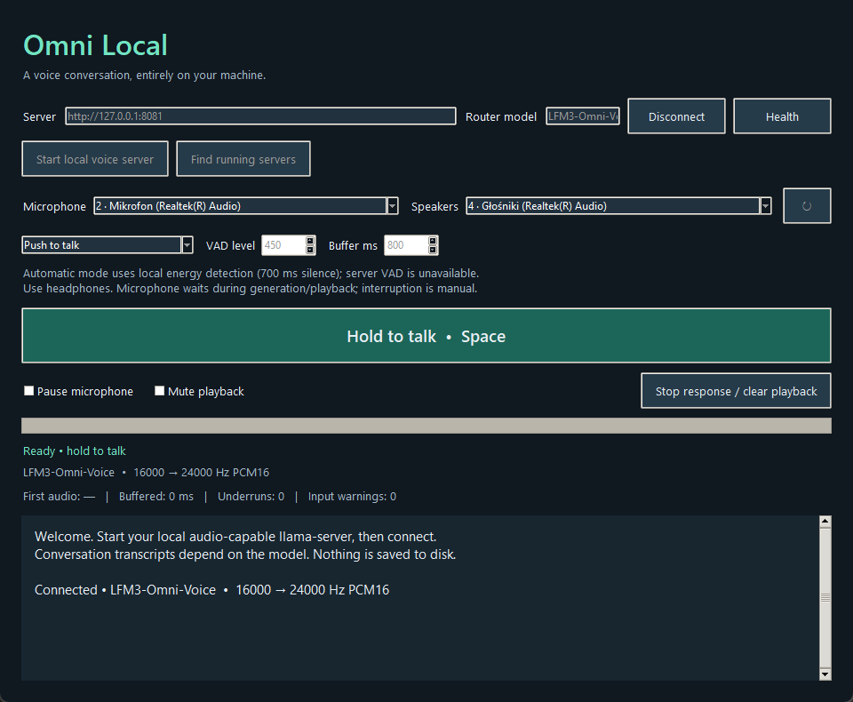

<div align="center">

# Omni Local

**Push to talk with a local LFM3 Omni model.** A small Windows desktop experiment for native voice on llama.cpp.

[](#quick-start)
[](#run-from-source)
[](#privacy)
[](#what-works-and-what-needs-work)



*A working prototype, with plenty of room for a visual polish pass.*

</div>

Omni Local streams microphone audio to an already-running local llama.cpp realtime server and plays back the model's native speech. The model and server stay on your computer. There is no Whisper service, third-party text-to-speech, cloud model, or automatic model download.

This project is an **early prototype**. Native audio has been verified with a real model, but voice interaction, interruption, device compatibility, and playback smoothness need broader testing and improvement. See [known limitations](#what-works-and-what-needs-work) before trying it.

## Quick start

### The Windows one-file app

1. Download `OmniLocal.exe` from a [GitHub release](https://github.com/NotCherry/omni-local/releases) when one is available. The executable bundles the GUI and audio-client dependencies, not the language model or llama.cpp server.
2. Install a current [llama.cpp build with LFM3 Omni realtime support](https://github.com/ggml-org/llama.cpp). Put the matching Omni GGUF and audio projector somewhere on your computer.
3. Start the server with both local model files. For example, in PowerShell:

   ```powershell
   llama-server.exe -m "C:\models\LFM3-Omni-2B-Q4_0.gguf" `
     --mmproj "C:\models\mmproj-LFM3-Omni-2B-Q8_0.gguf" `
     --host 127.0.0.1 --port 8080 --reasoning off -c 4096
   ```

   The projector quantization should match your model distribution. Do not use an unrelated model's projector. The server should advertise native audio input and output in `/v1/models`.
4. Open Omni Local, select that server address, choose your microphone and speakers, and click **Connect**. Hold **Hold to talk** or Space while focused; release to send. Headphones help avoid speaker-to-mic feedback.

The GUI currently reads an optional `settings.json` next to its source files or in an `OmniLocal` folder beside the executable. This file can set the server URL, model name, device-name preferences, and local server file paths. It contains machine-specific paths and is deliberately excluded from the repository.

### Run from source

Requires 64-bit Python 3.10–3.12 with tkinter, pip and venv. Python 3.13 is not supported yet because this prototype uses the standard-library `audioop` module.

```powershell
git clone https://github.com/NotCherry/omni-local.git
cd omni-local
powershell.exe -NoProfile -ExecutionPolicy Bypass -File .\Install.ps1
.\.venv\Scripts\python.exe .\app.py
```

The installer fetches the small pinned Python audio/WebSocket libraries from PyPI. It does not fetch models. To build a one-file Windows executable locally, run `powershell.exe -NoProfile -ExecutionPolicy Bypass -File .\Build.ps1`; output is `dist\OmniLocal.exe`.

## Controls

| Control | Behavior |
|---|---|
| Hold to talk / Space | Stream one user turn; releasing sends it for a reply. |
| Automatic · local energy VAD | Starts after a short energy threshold and sends after 700 ms of silence. This simple client-side threshold is noise-sensitive. |
| Pause microphone | Stops sending mic audio. An already-streamed turn cannot be taken back, so it is submitted. |
| Mute playback | Mutes and discards queued audio while text and generation continue. |
| Stop response / clear playback | Clears queued sound and requests server response cancellation. There is no automatic barge-in or echo cancellation. |
| Find running servers | Checks common local ports and sorts servers that advertise audio above text-only servers. |
| Start local voice server | Starts an explicitly configured server from existing local files and connects. No files are downloaded. |

The microphone pauses during model generation and playback. This prototype is half-duplex: wait for playback to finish before speaking again.

## What works and what needs work

**Verified:** real llama.cpp native realtime sessions; 16 kHz mono PCM16 input and 24 kHz output; local audio-to-audio model turns; assistant text and streamed model audio; real Windows microphone/speaker streams; mock WebSocket, turn, error and cancellation paths; and a packaged Windows GUI.

**Early-prototype limitations:**

- Playback may have audible gaps on some graphics and audio-device combinations. A longer playback buffer reduces gaps but adds delay.
- First-audio latency varies with model load and hardware. One Windows AMD Vulkan test took about 3.4 seconds after the audio turn ended. That is a measured example, not a performance promise.
- The available user transcript depends on the realtime model/server events; regular Omni conversation may not produce a transcript.
- Voice activity detection is a basic local RMS threshold, not a trained speech detector.
- Recording and playback are half-duplex. No automatic interruption, acoustic echo cancellation, or history trimming is implemented.
- Native audio needs a llama.cpp server build that supports the model **and** the matching audio projector. A loaded text-only Omni endpoint cannot provide voice output.
- The CUDA/RTX path, different GPUs, long conversations, language coverage and everyday microphone accuracy need more testing.

Contributions that improve the UI and make real conversations smoother are welcome. Good next steps include real-mic voice-turn testing, better buffering, trained local VAD, and stronger device recovery.

## Privacy

The client accepts loopback server addresses only (`localhost`, `127.0.0.1`, `::1`) and disables environment-proxy use for local requests. The app does not intentionally write microphone audio or chat history to disk. The optional settings file, server logs, and model files are controlled locally and are not committed. Install/build commands require network access for software dependencies; voice inference runs through the local server.

## Development

```powershell
python -m unittest -v test_client
python .\app.py --smoke-test
```

Tests use a local mock WebSocket server and fake audio streams. They do not benchmark GPU speed or verify real conversational accuracy. See [`test_client.py`](test_client.py) for coverage.

## License

The Omni Local client source is available under the MIT License. The llama.cpp engine, Python dependencies, the Liquid AI model, and any model/projector files retain their own licenses; see the upstream project and the model provider for their terms. The screenshot shows the prototype and is provided under this project's MIT License.

</div>
